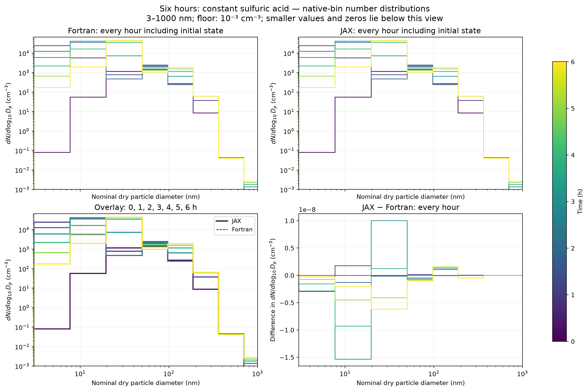
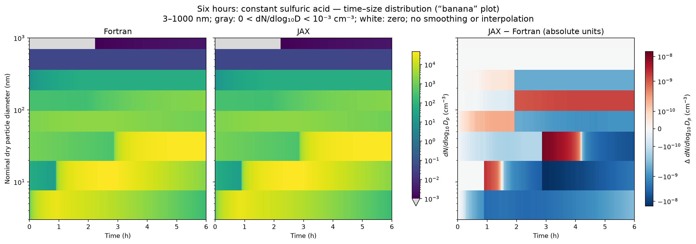
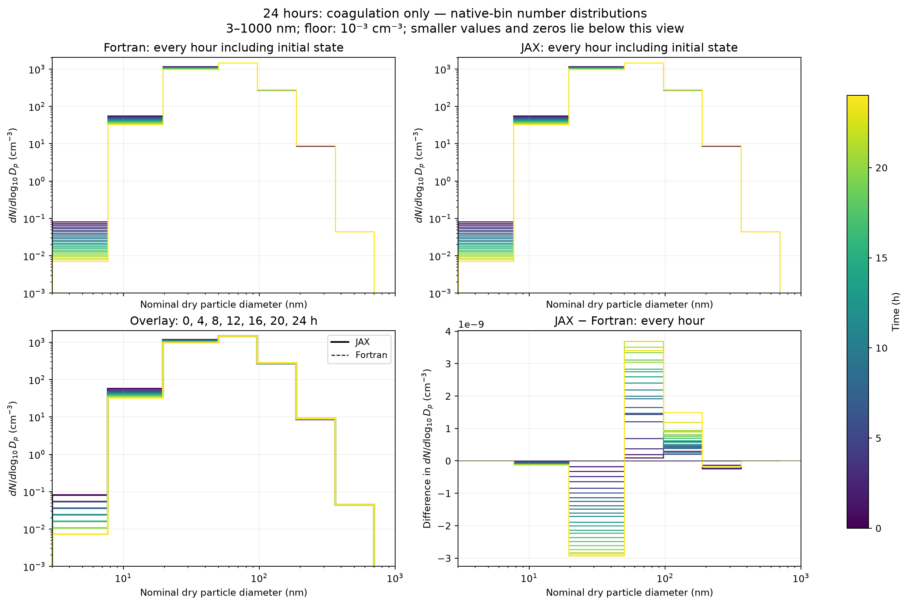
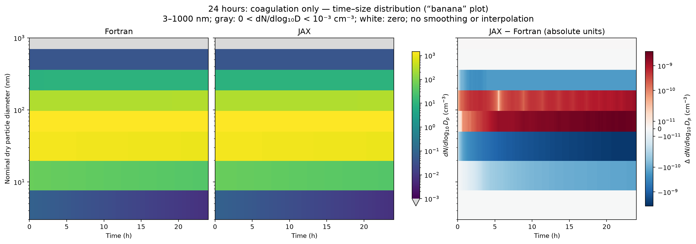

# Six-hour sulfuric-acid and 24-hour coagulation experiments

Recorded 2026-09-23 in the SALSA-JAX virtual environment: Python 3.12.12,
JAX 0.11.2, float64 CPU, GNU Fortran 16.1.0. Both requested experiments were
run through JAX and actual Fortran SALSA scientific modules. Checked and
optimized Fortran checkpoints match exactly. These are controlled core runs,
not the original HAM box driver or a performance benchmark.

## Initial conditions and forcing

| Setting | Six-hour coupled run | 24-hour coagulation run |
|---|---|---|
| Aerosol composition | Pure sulfate, soluble bins only | Same |
| Initial number | 1000 particles/cm³ | Same |
| Initial number distribution | Lognormal, geometric mean dry diameter 50 nm, geometric standard deviation 1.6 | Same |
| Temperature / pressure / RH | 280 K / 101325 Pa / 50% | Same |
| Gas H₂SO₄ | 10⁸ molecules/cm³, replenished every step | Zero, no supply |
| Coagulation | Enabled | Enabled |
| Condensation | Enabled | Disabled |
| Nucleation | Activation scheme 2, growth option 1 | Disabled |
| Diameter recalculation | Enabled | Enabled |
| Timestep / saved interval | 1 s / 60 s | Same |

The user's concentration is interpreted as molecules/cm³, equivalent to 10¹⁴
molecules/m³ internally. Number is integrated over each of the ten native
soluble-bin edges without renormalization. All seven insoluble bins, other
species and other gases start at zero and remain zero. Represented initial
number is 999.999998924 particles/cm³ because of the unrepresented lower tail.
Each bin's dry material uses the native midpoint particle volume. This preserves
the integrated bin number, **not the analytic lognormal third moment**, and
avoids an initial mismatch with the remapper's target midpoints.

Constant vapor means restoring gas to its target **after every complete SALSA
call**, with signed external sulfur makeup recorded. Depletion inside each
call is retained. Maximum depletion during a 1 s step is 0.873%; at 0.5 s it is
0.440%. Thus this is a tested discrete reservoir approximation, not a change
to native condensation or nucleation equations. Budgets include added sulfur.

## Hourly distributions and banana plots

Number spectra are `dN/dlog10(Dp)` in cm⁻³, using **exact native dry-bin widths**.
There is no smoothing or interpolation. The banana plots use all one-minute
checkpoints; hourly plots include the initial state and every integer hour.
Ten populated soluble bins give visibly coarse steps. Insoluble bins overlap
in diameter and are empty, so they are not drawn as extra diameter intervals.









The main figures focus on 3–1000 nm and concentrations at or above
10⁻³ cm⁻³ per log-diameter interval. Full-range PNG/SVG figures and all-bin CSV
values are also generated; display limits do not alter the simulations.

## Numerical comparison and timestep sensitivity

| Result, 1 s timestep | Six-hour coupled | 24-hour coagulation |
|---|---:|---:|
| Final JAX number, particles/cm³ | 19631.045360473 | 908.713363025 |
| Final Fortran number, particles/cm³ | 19631.045360476 | 908.713363025 |
| Maximum bin-number absolute JAX–Fortran difference, particles/cm³ | 6.42×10⁻⁹ | 1.20×10⁻⁹ |
| Maximum number-distribution relative L1 difference | 5.48×10⁻¹³ | 2.87×10⁻¹² |
| Maximum per-bin number relative difference | 7.60×10⁻¹¹ | 2.60×10⁻⁹ |
| Maximum every-step relative sulfur residual, JAX / Fortran | 1.01×10⁻¹² / 5.20×10⁻¹³ | 6.76×10⁻¹² / 3.86×10⁻¹² |

Both implementations remain finite and nonnegative. They are visually
indistinguishable on the number spectra, but **the existing strict 3×10⁻¹¹
relative comparison gate fails**: number in the coupled run, and number,
mass and several geometry fields in the coagulation run. No tolerance was
widened. Small relative differences in sparsely populated bins need to remain
visible even when their absolute contribution is negligible. These long runs
are diagnostic evidence, not an extension of strict trajectory acceptance.

Both cases were repeated at 0.5 s with identical physical duration and saved
times. For the coupled run, maximum number-distribution relative L1 change is
**0.573%**; at six hours it is **0.126%**, and final aerosol-mass distribution
change is **0.383%**. Final number becomes 19628.902282 particles/cm³. For
coagulation, maximum number L1 change is **0.0000504%** and mass L1 change is
**0.000313%**. JAX and Fortran show the same timestep sensitivity. These are
two-resolution comparisons, not a demonstrated asymptotic convergence order.

## What this says about jaggedness

The coarse stepped appearance occurs in **both** implementations. The growth
banana plots also show pronounced transitions between the smallest bins,
including around one and three hours, shared by both languages. The
coagulation-only distribution retains one broad mode; the coupled case adds
and grows a small-particle population across wide native bins. No visually
resolvable JAX-specific jaggedness appears in these comparisons.

An additional 24-hour control disables coagulation, condensation and
nucleation while retaining native hydration, remapping and correction.
Maximum number-distribution drift from its initial state is 2.73×10⁻¹⁵
relative L1 in JAX and 5.98×10⁻¹⁶ in Fortran; mass drift is below 4.87×10⁻¹⁵.
This rules out spontaneous drift **for the chosen midpoint initialization**.
It does not test remapping accuracy while particles grow or cross bin edges.

Conservation cannot determine whether material reaches the correct receiving
bin, and agreement with Fortran cannot validate a shared numerical method.
The next discriminating test is an independent high-resolution size-grid
reference or controlled growth/remapping benchmark. Soluble-only runs also do
not exercise the known cross-regime D009 defect. No scientific repair was made.

## Reproduction and artifacts

Use fresh output directories; install the existing optional plotting dependency:

```sh
.venv/bin/python -m pip install -e '.[plot]'
.venv/bin/python -m tools.run_long_sulfuric_acid \
  --config configs/sulfuric-acid-six-hours.toml --output outputs/acid-six-hours
.venv/bin/python -m tools.run_long_sulfuric_acid \
  --config configs/coagulation-24-hours.toml --output outputs/coagulation-24-hours
.venv/bin/python -m tools.plot_long_sulfuric_acid \
  --run-directory outputs/acid-six-hours --output outputs/acid-six-hours/figures
.venv/bin/python -m tools.plot_long_sulfuric_acid \
  --run-directory outputs/coagulation-24-hours --output outputs/coagulation-24-hours/figures
```

The simulation commands intentionally return status 1 on strict comparison
failure while saving diagnostic outputs. Inspect `report.json`; do not treat
that exit status as a missing trajectory. Each directory contains initial state,
`jax.npz`, `fortran.npz`, exact `bins.csv`, per-implementation time series and
bin-number CSVs, and source/compiler/configuration hashes. Plot directories
contain hourly `dN/dlog10(Dp)` CSV, PNG/SVG figures, and plot reports.
Committed hourly tables: [six-hour run](evidence/six-hour-hourly-2026-09-23.csv)
and [24-hour run](evidence/coagulation-24-hour-hourly-2026-09-23.csv).
[Six-hour plot hashes](evidence/six-hour-plots-2026-09-23.json) and
[24-hour plot hashes](evidence/coagulation-24-hour-plots-2026-09-23.json)
link figures and tables to their simulation inputs.

Generate the refinement and control runs through the same runner:

```python
from dataclasses import replace
from tools.long_sulfuric_acid import load_experiment
from tools.run_long_sulfuric_acid import run
acid = load_experiment('configs/sulfuric-acid-six-hours.toml')
coag = load_experiment('configs/coagulation-24-hours.toml')
run(replace(acid, timestep_s=0.5), 'outputs/acid-half')
run(replace(coag, timestep_s=0.5), 'outputs/coag-half')
run(replace(coag, label='24 hours: remapping-only control', coagulation_enabled=False),
    'outputs/remapping-control')
```

Run that snippet with `.venv/bin/python`. Combine the five reports with
`tools.summarize_long_sulfuric_acid` (`--acid`, `--coagulation`, `--acid-half`,
`--coagulation-half`, `--control`, `--output`). It verifies artifact hashes and
compares equal-time arrays. The [recorded evidence](evidence/long-sulfuric-acid-2026-09-23.json)
retains all five configurations, scientific source hashes, original strict
failures, budgets and refinement/control metrics. Local full outputs use
`outputs/*-2026-09-23/`; generated binaries and full trajectories are ignored.

Validation: `.venv/bin/python -m pytest -q` completed with **966 passed**
in 214.17 s. New tests cover reservoir replay, native checkpoint stride,
initialization, saved units/hashes and faithful strict-failure reporting.
The five long runs and visual inspections are separate recorded evidence;
their strict comparison failures remain open.
