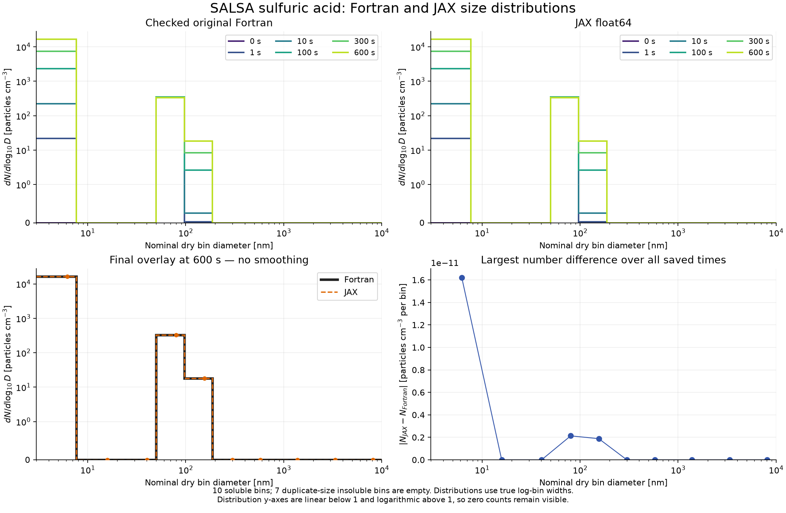

# Sulfuric-acid-only experiment

This runnable experiment combines the accepted SALSA coagulation, H₂SO₄
condensation and sulfate nucleation kernels, including water equilibration,
particle-size updates and both native remapping passes. It starts with pure
sulfate in soluble bins. Temperature, pressure and relative humidity stay fixed.
A constant H₂SO₄ source is added **before each step**; this is a controlled
experiment, not the original driver's prescribed gas-concentration overwrite.

## Run and configure

From the SALSA-JAX checkout, using its existing virtual environment:

```sh
.venv/bin/python -m tools.run_sulfuric_acid \
  --config configs/sulfuric-acid.toml \
  --output outputs/sulfuric-acid --compare-fortran
```

Use a fresh output directory. GNU Fortran must be available for
`--compare-fortran`; omit that flag to run JAX with sulfur-budget checks only.
The command exits nonzero for failed comparison, invalid states or sulfur
budgets. `report.json` distinguishes a native comparison from a JAX-only run.
No production Fortran source or scientific input is modified.

Edit a copy of [the configuration](../../configs/sulfuric-acid.toml). It contains
all experiment settings, including timestep/count, environment, initial H₂SO₄,
source rate and ten soluble-bin particle counts. Counts are particles/m³;
`1e8` means 100 particles/cm³. The remaining seven insoluble bins are empty.
Each populated bin starts at its native dry midpoint size with sulfate alone;
the mixed-material `conc2mmr` initialization recipe is deliberately not used.

- Set `h2so4_source_molecules_m3_s = 0.0` for a closed sulfur inventory.
- Set `nucleation_scheme = 0` for condensation without nucleation.
- Set `coagulation_enabled = false` to isolate condensation plus nucleation.
- Set scheme 0 and `condensation_enabled = false` for coagulation only.
- Schemes 1/2/3 are binary H₂SO₄/water, boundary-layer activation and kinetic
  nucleation. This experiment uses the boundary-layer branch. Growth options
  1–3 retain native formulas; the supplied default is growth 1.

The default runs 600 one-second steps at 280 K, 101325 Pa and RH 0.5. It starts
with 100 particles/cm³ in soluble bin 4 (about 80 nm), H₂SO₄ at `1e14`
molecules/m³, and a source of `1e11` molecules/m³/s. These are explicit example
settings, not a calibrated atmospheric scenario.

## Outputs and units

- `timeseries.csv`: initial state and every timestep, including H₂SO₄ vapor,
  aerosol sulfate, total particle number, expected sulfur and residual.
- `number-distribution.csv`: number in every bin at every time, particles/m³.
- `bins.csv`: nominal dry diameter edges/midpoints in meters. Divide a bin count
  by `log10(upper/lower)` to obtain `dN/dlog10(D)`.
- `trajectory.npz`: all seven native output fields at every step and separate
  initial mass/number/gas arrays. Actual dry/wet radii are retained, not only
  nominal bin positions. Optional `fortran-trajectory.npz` holds the reference.
- `report.json`: configuration, numerical/budget gates, compiler and source
  hashes. The generated README explains the native mixed-unit array layout.

The sulfur inventory is `gas_H2SO4 + 1e6*sum(aerosol_SO4)`, in sulfur atoms/m³.
Aerosol sulfate uses native molecules/cm³; gas uses molecules/m³. Expected
inventory is initial sulfur plus source rate × elapsed time. Water contains no
sulfur. The native sulfate species molar mass is 96.0631 g/mol; replacing it with
98 g/mol would change the reference. SO₂ chemistry is outside this experiment.

## Model assumptions awaiting owner review

See the [six owner-review items](salsa-owner-review.md) for density assumptions,
dry-midpoint kernel rescaling, pair-mean Fuchs distance, RH clamping, D009 and
standalone switch configuration. In particular, **RH = 0 is not a dry mode**:
the native hydration calculation clamps it to 0.05. The example exposes its
nucleation switches directly, bypassing the standalone namelist-read limitation.
These modeling choices remain unchanged despite numerical agreement with Fortran.

## Validation and scientific limits

The dedicated reference compiles the original five SALSA scientific modules
byte for byte. Only a separate driver supplies the initial state, adds the
source and records each step. Tests first compare zero-source prefixes against
the existing native oracle and a forced step against a manually supplied input.

```sh
.venv/bin/python -m pytest -q tests/test_sulfuric_acid.py \
  tests/test_sulfuric_acid_oracle.py tests/test_sulfuric_acid_validation.py \
  tests/test_sulfuric_acid_trajectories.py
.venv/bin/python -m tools.validate_sulfuric_acid \
  --output build/sulfuric-acid-validation
```

The matrix includes 1000-step isolated coagulation and condensation, closed
coupled trajectories for all nine nucleation scheme/growth combinations,
the 600-step supplied-vapor example and an empty-background regression. Binary
cases use 260 K so nucleation is active. All seven fields are compared at every
step; checked and optimized Fortran arrays must agree exactly. A second run at
0.5 s covers the same 600 s physical duration and records timestep sensitivity.
One refinement does not establish a convergence rate.

Trajectory parity uses relative tolerance `3e-11`, distinct from the stricter
single-call tests. Reference zeros remain exact except for the already accepted
wet-minus-dry water cancellation allowance. Sulfur residual must be within
`1e-10` of initial plus supplied inventory. These gates are independent: matching
a nonconservative reference would not pass the sulfur budget.

Two restrictions remain explicit:

1. **Empty background:** native coupling requires a positive background sink.
   It therefore fails to insert particles into an entirely particle-free box,
   even when an isolated nucleation calculation returns a positive source.
2. **Sparse coagulation/remapping:** turning condensation off with the default
   single occupied bin produces a tiny receiving-bin transfer with a relative
   JAX/Fortran difference around `4.4e-9`. A one-ULP native initial-mass change
   produces `4.3e-9` in Fortran itself. This case remains **unaccepted by the
   strict parity gate** and has a separate reproducer. The ordinary long
   coagulation acceptance case populates all ten soluble bins; no tolerance is
   widened to hide the sparse-case discrepancy.

Empty insoluble bins avoid the known cross-regime coagulation volume-creation
case; they do not repair it. Native growth-option arithmetic is retained.
Budgets and finite-state checks here apply to the recorded configurations,
not arbitrary timestep/concentration choices. The broader HAM wrapper,
radiation and full box driver are not prerequisites for this experiment.


## Recorded results

The [all-step evidence](evidence/sulfuric-acid-trajectories-2026-09-22.json)
records 13 standard scenarios and the half-timestep run. Maximum relative
field error in standard scenarios is `5.82e-12`; maximum sulfur-budget residual
across JAX and Fortran is `1.01e-13`. Checked and optimized Fortran outputs agree
exactly. The sparse coagulation limitation is recorded separately, explicitly
outside strict acceptance.

For the supplied 600 s example, particle number grows from 100 to about
6841 particles/cm³. Final H₂SO₄ is `1.45348e14 molecules/m³`; total supplied
sulfur is `6e13 molecules/m³`. The source exceeds vapor uptake here, so gas
rises despite condensation. Closed-source cases separately verify depletion.

Halving the timestep changes final number-distribution L1 by about **0.0172%**,
aerosol mass-distribution L1 by **0.00181%**, and gas by **0.000738%** relative
to the fine result. Fortran shows the same changes. These quantify timestep
sensitivity for this example; they do not assert universal convergence or a
scientific repair. Existing process CPU benchmarks remain applicable to their
own workloads; these trajectory comparisons make no new speedup claim.


## Visual comparison of size distributions

The saved 600 s example has now been plotted side by side and overlaid with its
checked Fortran trajectory. Both show the same sparse, stepped distribution.
The maximum per-bin number difference over all saved times is
`1.62e-11 particles/cm³` (maximum nonzero relative difference `2.61e-12`).
See the [plot data and input hashes](evidence/sulfuric-acid-size-distributions-2026-09-22.json).



This example initially puts all particles in soluble bin 4, near 80 nm.
Nucleation adds particles to bin 1; bins 2 and 3 remain empty during the recorded
600 s. The first three bin intervals span approximately 3–7.66, 7.66–19.57 and
19.57–50 nm. Such coarse bins and a deliberately concentrated seed cannot
provide a smooth size spectrum. The figure establishes that the visible shape
is shared with Fortran; it does not establish grid convergence or explain the
jaggedness of every other SALSA scenario.

Distributions use `dN/dlog10(D)`, normalized by each bin's actual logarithmic
width, and are drawn as steps without smoothing. The seven empty 2b bins are
excluded: their diameter range duplicates 2a and should not be appended as if
all 17 bins formed one increasing diameter axis. Distribution y-axes are linear
below 1 and logarithmic above 1 so true zero counts remain visible.

Reproduce the PNG, editable SVG and numerical report with optional plotting
support installed in the same virtual environment:

```sh
.venv/bin/python -m pip install -e '.[plot]'
.venv/bin/python -m tools.plot_sulfuric_acid \
  --run-directory outputs/sulfuric-acid \
  --output outputs/sulfuric-acid-figures
```

The input run must include `--compare-fortran`. The plotting command verifies
input hashes and matching times before drawing, and requires a fresh output
directory. Recorded rendering used Matplotlib 3.11.2. Scientific kernels and
trajectory data are unchanged.
